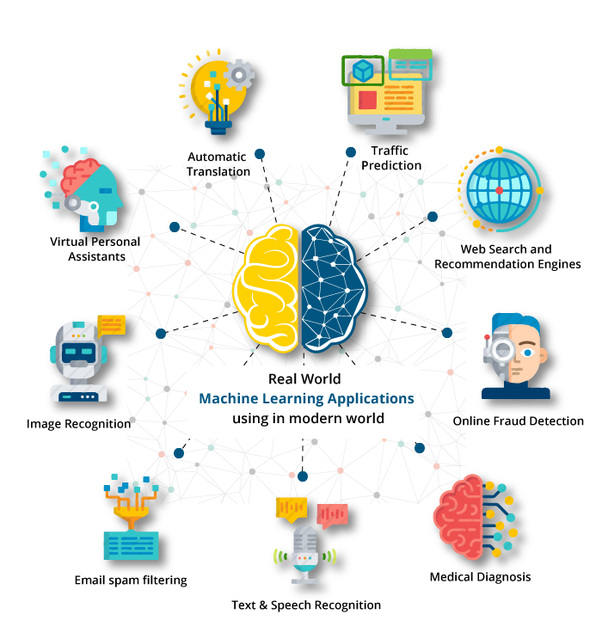

## Welcome to Week 8

::: {.card-grid .cols-3}
::: {.card}
[Part 1]{.card-title}

Midterm wrap-up & peer reviews
:::
::: {.card}
[Part 2]{.card-title}

What is machine learning, and what problems can it solve?
:::
::: {.card}
[Part 3]{.card-title}

What does it take to do ML *well*? A case study to see it in action
:::
:::

# Midterm Wrap-Up {background="#43464B"}

## Midterm: Your Honest Feedback {.smaller}

I want to hear what worked and what didn't. **Your feedback shapes how I run this project next time.**

::: {.card-grid .cols-3}
::: {.card}
[👍 Keep]{.card-title}

What did you like? What should I definitely keep?
:::
::: {.card}
[👎 Didn't work]{.card-title}

What was frustrating, confusing, or not worth the effort?
:::
::: {.card}
[🔧 Change]{.card-title}

If you could change one thing about the project, what would it be?
:::
:::

<br>

::: {.big-statement style="font-size: 1.1em;"}
No wrong answers, and nothing you say here affects your grade.
:::

::: {.notes}
Keep this to a few minutes and resist the urge to defend design choices — just listen and maybe jot notes. Possible follow-up prompts if the room is quiet:

- Was the scope about right for the time you had?
- Were the instructions and rubric clear?
- Did the dataset feel interesting / realistic?
- Which week's material did you lean on most? Least?
- Was there anything you wished we'd covered before the project?
:::

## Peer Reviews Due Thursday {.smaller}

::: {.callout-important}
## Due by end of day Thursday

Review your assigned classmate's project and give **specific, constructive** feedback on:

* Data analysis approach
* Visualization effectiveness
* Business recommendations
* Code organization and clarity
:::

**Questions about the peer review process?**

# From Describing to Predicting {background="#43464B"}

## For Seven Weeks You've Asked...

::: {.big-statement}
"What **happened**?"
:::

. . .

::: {.big-statement}
Today we start asking:<br>"What will **likely happen next**?"
:::

::: {.notes}
Frame the transition: everything so far (importing, wrangling, aggregating, visualizing) answers descriptive questions about the past. ML lets us use those same data skills to make predictions about new cases and discover structure we didn't know to look for. And EDA doesn't go away — it's the foundation of every ML project.
:::

## Be the Algorithm {.smaller}

:::: {.columns}
::: {.column width="55%"}
**Homes sold over the past three months**

::: {.data-demo}
| Month | House | Sq. ft. | Beds | Sale price |
|:-----:|:-----:|--------:|:----:|-----------:|
| Jul | A | 1,000 | 2 | $120,000 |
| Jul | B | 1,400 | 3 | $165,000 |
| Aug | C | 1,800 | 3 | $210,000 |
| Aug | D | 2,200 | 4 | $255,000 |
| Sep | E | 2,600 | 4 | $300,000 |
:::

*Weeks 1–7: summarize & aggregate what already happened*
:::
::: {.column width="45%" .fragment}
**Homes going up for sale next month**

::: {.data-demo}
| Month | House | Sq. ft. | Beds | Sale price |
|:-----:|:-----:|--------:|:----:|-----------:|
| Oct | G | 1,600 | 3 | [**?**]{.cell-unknown} |
| Oct | H | 3,000 | 5 | [**?**]{.cell-unknown} |
:::

*Now: predict what we expect to happen*
:::
::::

. . .

**What do you think houses G and H will sell for? How did you come up with your guesses?**

::: {.notes}
First build: the historical sales. This is everything weeks 1–7 taught them to do: average price by month, price per sq. ft., price by bedroom count. All descriptive, all about homes that already sold.

Second build: next month's listings, with no sale price yet. A seller, buyer, or agent doesn't just want to know what happened; they want to know what to expect. That's the shift to prediction.

Third build: have students guess. The toy data follows roughly $112.50 per sq. ft. + $7,500, so G is about $187,500 and H about $345,000. Most students will land close. Ask how they did it — you want them to say "I noticed price goes up about $45K for every 400 sq. ft." That's the punchline on the next slide.
:::

## What You Just Did *Is* Machine Learning

::: {.flow}
::: {.card}
[📋 Examples]{.card-title}

Houses A–E, with known sale prices
:::
[➜]{.arrow}

::: {.card}
[🧠 Find the pattern]{.card-title}

"About $110K more per 1,000 sq. ft."
:::
[➜]{.arrow}

::: {.card}
[🔮 Apply it]{.card-title}

Predict prices for new houses G & H
:::
:::

. . .

::: {.big-statement}
**Machine learning:** algorithms that learn patterns from examples, then apply those patterns to new data.
:::

::: {.notes}
The only difference between you and an ML algorithm: the algorithm can do this with millions of rows and hundreds of columns, and it finds the pattern with math instead of intuition.
:::

## Key Vocabulary {.smaller}

:::: {.columns}
::: {.column width="58%"}
::: {.data-demo}
| sq_ft | bedrooms | neighborhood | sale_price |
|------:|:--------:|:------------:|-----------:|
| 1,000 | 2 | Midtown | [$120,000]{.cell-target} |
| 1,400 | 3 | Oakley | [$165,000]{.cell-target} |
| 1,800 | 3 | Hyde Park | [$210,000]{.cell-target} |
| 1,600 | 3 | Oakley | [?]{.cell-unknown} |
| 3,000 | 5 | Hyde Park | [?]{.cell-unknown} |
:::
:::
::: {.column width="42%"}
::: incremental
* **Features (X):** the input columns we know — `sq_ft`, `bedrooms`, `neighborhood`
* [**Target (y):**]{.cell-target} the column we want to predict — `sale_price`
* **Training data:** rows where we *know* the target
* [**New data:**]{.cell-unknown} rows where the target is unknown — that's where the model **predicts**
:::
:::
::::

::: {.notes}
Every ML week from here on uses these four words. Point out that the dataset needs one row per "thing we predict" — one row per house here.
:::

## Now Let the Computer Play {.smaller}

Same game, real data: 1,460 houses from Ames, Iowa.

```{python}
import pandas as pd
from sklearn.linear_model import LinearRegression

ames = pd.read_csv("../data/ames_clean.csv")

model = LinearRegression()
model.fit(ames[["GrLivArea"]], ames["SalePrice"])     # learn from examples

new_houses = pd.DataFrame({"GrLivArea": [1600, 3000]})
model.predict(new_houses)                             # predict new cases
```

. . .

::: {.callout-tip}
**`fit()` on examples, `predict()` on new cases.** Weeks 9–14 are about doing this *well*: choosing the right model, measuring how good it is, and avoiding the traps we'll cover today.
:::

::: {.notes}
Don't teach scikit-learn syntax yet. The point is that ML isn't magic — the model's guesses (~$190K and ~$340K) are close to what the class guessed for houses G and H.
:::

## Same Data, Two Kinds of Questions {.smaller}

Remember the Complete Journey grocery data? The same tables can answer very different questions:

::: {.card-grid .cols-2}
::: {.card}
[📊 EDA questions: *What happened?*]{.card-title}

Which departments drove the most sales last quarter?

How does spending differ across income levels?

Which coupons were redeemed most often?

What were our busiest days of the week?
:::
::: {.card}
[🔮 ML questions: *What will likely happen next?*]{.card-title}

How much will each household spend next month?

Which households are likely to stop shopping with us?

Will this household redeem the coupon we send them?

What will be our busiest day and time next week?
:::
:::

. . .

::: {.callout-tip}
## Why this matters

More and more organizations are investing in ML because it tells them **what to expect next**, so they can make important decisions **now** based on those expectations.
:::

::: {.notes}
Students have answered left-column questions all semester with merge, groupby, and charts. Right-column questions use the same tables but ask about the future or about hidden structure. Each ML question previews a type we'll formalize shortly: spend next month and next week's traffic (regression), likely to stop shopping and coupon redemption (classification). The busiest-time question pairs nicely with the left column's "busiest days" question: same topic, past vs. future.
:::

## ML Is Already All Around You {.smaller}

{width="85%" fig-align="center"}

::: {.notes}
Ask: which of these did you use today? Spam filters, recommendations, maps ETAs, fraud alerts, autocorrect. ML isn't futuristic — it's routine.
:::

# What Problems Can ML Solve? {background="#43464B"}

## Three Questions ML Answers {.smaller}

::: {.card-grid .cols-3}
::: {.card}
[📈 How much? How many?]{.card-title}

**Regression** — predict a *number*

*What will this house sell for?*

*How many units will we sell next week?*

*How much will this customer spend next year?*
:::
::: {.card}
[🏷️ Which one? Yes or no?]{.card-title}

**Classification** — predict a *category*

*Is this transaction fraud?*

*Will this customer cancel?*

*Is this review positive, negative, or neutral?*
:::
::: {.card}
[👥 What groups exist?]{.card-title}

**Clustering** — discover *structure*

*What types of shoppers do we have?*

*Which stores behave alike?*

*What viewing patterns exist?*
:::
:::

. . .

::: {.callout-note}
Regression & classification are **supervised**: we have a target to learn from (an "answer key"). Clustering is **unsupervised**: no target, the algorithm finds groups on its own.
:::

## Choosing the Right Tool {.smaller}

::: {.card .tree-root}
[What do you need to know?]{.card-title}
:::

::: {.card-grid .cols-3}
::: {}
[↓]{.tree-down}

::: {.card}
[What happened?]{.card-title}

Summarize the past
:::
[↓]{.tree-down}

::: {.card .answer-card}
[📊 EDA]{.card-title}

groupby, charts, dashboards
:::
:::
::: {}
[↓]{.tree-down}

::: {.card}
[What will happen?]{.card-title}

There's a known outcome to learn from. Is it a **number** or a **category**?
:::
[↓]{.tree-down}

::: {.card-grid .cols-2 style="margin-top: 0;"}
::: {.card .answer-card}
[📈 Regression]{.card-title}

number
:::
::: {.card .answer-card}
[🏷️ Classification]{.card-title}

category
:::
:::
:::
::: {}
[↓]{.tree-down}

::: {.card}
[What groups exist?]{.card-title}

No outcome to learn from
:::
[↓]{.tree-down}

::: {.card .answer-card}
[👥 Clustering]{.card-title}

discover structure
:::
:::
:::

::: {.notes}
This is the decision tree for the rapid-fire round that follows. Emphasize that "What happened?" is still a perfectly good — often better — question. Not every problem needs ML.
:::

## Rapid Fire: EDA or ML? {.smaller}

For each scenario, hold up fingers to vote:

::: {.card-grid .cols-4}
::: {.card}
[☝️ 1]{.card-title}

**EDA**

Describe what happened
:::
::: {.card}
[✌️ 2]{.card-title}

**Regression**

Predict a number
:::
::: {.card}
[🤟 3]{.card-title}

**Classification**

Predict a category
:::
::: {.card}
[🖖 4]{.card-title}

**Clustering**

Discover groups
:::
:::

<br>

You've got about 10 seconds per scenario. Use the flowchart!

## Scenario 1 of 8

::: {.scenario}
A retailer wants to know which **regions had the highest sales last quarter**.
:::

::: {.legend}
1 EDA · 2 Regression · 3 Classification · 4 Clustering
:::

. . .

::: {.answer}
**☝️ EDA** — it's a summary of the past. One `groupby` answers it; no model needed.
:::

## Scenario 2 of 8

::: {.scenario}
A hospital wants to flag which patients are likely to be **readmitted within 30 days** of discharge.
:::

::: {.legend}
1 EDA · 2 Regression · 3 Classification · 4 Clustering
:::

. . .

::: {.answer}
**🤟 Classification** — predict a yes/no outcome for each new patient, learned from past patients.
:::

## Scenario 3 of 8

::: {.scenario}
A streaming service wants to discover the **different types of viewing behavior** among its subscribers.
:::

::: {.legend}
1 EDA · 2 Regression · 3 Classification · 4 Clustering
:::

. . .

::: {.answer}
**🖖 Clustering** — there's no target; we want the data to reveal the groups.
:::

## Scenario 4 of 8

::: {.scenario}
A retailer wants to predict **how much revenue each customer will generate next year**.
:::

::: {.legend}
1 EDA · 2 Regression · 3 Classification · 4 Clustering
:::

. . .

::: {.answer}
**✌️ Regression** — the outcome is a dollar amount for each customer.
:::

## Scenario 5 of 8

::: {.scenario}
A marketing team wants a **dashboard showing customer demographics** by region.
:::

::: {.legend}
1 EDA · 2 Regression · 3 Classification · 4 Clustering
:::

. . .

::: {.answer}
**☝️ EDA** — summarizing and visualizing what's already in the data. Using ML here would be overkill.
:::

## Scenario 6 of 8

::: {.scenario}
A bank needs to **automatically flag fraudulent credit card transactions** as they happen.
:::

::: {.legend}
1 EDA · 2 Regression · 3 Classification · 4 Clustering
:::

. . .

::: {.answer}
**🤟 Classification** — fraud / not fraud, learned from past transactions that were confirmed as fraud.
:::

## Scenario 7 of 8

::: {.scenario}
A grocery chain wants to forecast **how many gallons of milk each store will sell next week**.
:::

::: {.legend}
1 EDA · 2 Regression · 3 Classification · 4 Clustering
:::

. . .

::: {.answer}
**✌️ Regression** — the outcome is a quantity.
:::

## Scenario 8 of 8

::: {.scenario}
Kroger wants to find **shoppers with similar baskets** so it can tailor coupons to each group.
:::

::: {.legend}
1 EDA · 2 Regression · 3 Classification · 4 Clustering
:::

. . .

::: {.answer}
**🖖 Clustering** — nobody has labeled the "types" of shoppers; the algorithm discovers them.
:::

::: {.notes}
Bonus discussion: once you have the clusters, which coupon each group responds to could become a classification problem. Real projects often chain these together.
:::

# What Does ML Require? {background="#43464B"}

## When ML Goes Wrong {.smaller}

::: {.card-grid .cols-2}
::: {.card .fragment}
[🏠 Zillow Offers (2021)]{.card-title}

Zillow used its home-price predictions to buy houses directly. When the market shifted, it overpaid for thousands of homes, wrote down $300M+, and shut the business down.

[A prediction isn't a business plan: define the decision, the risk, and how you'll measure success.]{.card-lesson}
:::
::: {.card .fragment}
[📄 Amazon Recruiting Tool (2018)]{.card-title}

Trained on 10 years of résumés, mostly from men. It learned to downgrade résumés from women, picking up on clues like "women's chess club" or all-women's colleges. Amazon scrapped it.

[Biased history in → biased predictions out.]{.card-lesson}
:::
::: {.card .fragment}
[🤒 Google Flu Trends (2013)]{.card-title}

Predicted flu levels from search queries. During the 2012–13 season it estimated roughly *double* the actual peak. Search behavior had changed; the model hadn't.

[Your data must reflect the world you're predicting, and keep reflecting it.]{.card-lesson}
:::
::: {.card .fragment}
[🛒 Target Pregnancy Model (2012)]{.card-title}

A model inferred pregnancy from shopping baskets and mailed baby coupons, reportedly before one teen's family knew.

[Being able to predict something doesn't mean you should act on it.]{.card-lesson}
:::
:::

::: {.notes}
Reveal one at a time. For each, ask "Was this a bad algorithm?" before revealing the lesson. The answer is almost always no.
:::

## Notice a Pattern?

::: {.big-statement}
None of these failed because of a **bad algorithm**.
:::

. . .

::: {.big-statement}
They failed on **problem framing**, **data**, and **ethics**: decisions made *before* anyone trained a model.
:::

## The ML Project Canvas {.smaller}

Eight questions to answer **before** you write any modeling code:

::: {.card-grid .cols-4}
::: {.canvas-box}
[① Is ML the right tool?]{.card-title}

Could a rule, query, or dashboard do the job?
:::
::: {.canvas-box}
[② Problem statement]{.card-title}

Predict ___ for ___ within ___ so that ___ can ___.
:::
::: {.canvas-box}
[③ Target & unit]{.card-title}

What exactly is *y*? One row = one what?
:::
::: {.canvas-box}
[④ Action]{.card-title}

Who uses the prediction, and what do they do differently?
:::
::: {.canvas-box}
[⑤ Success metrics]{.card-title}

A **model** metric *and* a **business** metric
:::
::: {.canvas-box}
[⑥ Data readiness]{.card-title}

Sources, quality issues, and how we'll split train/test
:::
::: {.canvas-box}
[⑦ Leakage risks]{.card-title}

What *wouldn't* be known at prediction time?
:::
::: {.canvas-box}
[⑧ Ethics]{.card-title}

Fairness, privacy, interpretability
:::
:::

. . .

We'll fill it in for a case study today, and you'll put it to work in Thursday's lab.

::: {.notes}
Boxes 1–5 are "clear problem + success metrics." Box 6 is "clean, ready data." Boxes 7–8 are the traps. This maps directly to chapter 20.
:::

# Case Study: StreamFlix {background="#43464B"}

## The Request {.smaller}

**StreamFlix**: 2M+ subscribers, losing **5% per month** (~$15M+ annual impact). The VP of Customer Success emails you:

<br>

::: {.big-statement style="font-size: 1.15em; text-align: left;"}
*"Our customer churn is killing us! Can you build an [AI model]{.fragment .highlight-red} to predict [which customers will cancel]{.fragment .highlight-red} so we can [save them]{.fragment .highlight-red}? We need this [ASAP]{.fragment .highlight-red} for next quarter's retention campaign."*
:::

<br>

**What's vague or risky about this request?**

::: {.notes}
Let students call out issues before revealing each highlight.

- "AI model": the request names a solution before the problem is clear
- "which customers will cancel": cancel *when*? Next week? Ever?
- "save them": how? Discounts? Calls? What's the budget and capacity?
- "ASAP": rushed timelines are how leakage and bias slip through
:::

## ① Is ML the Right Tool?

::: {.big-statement}
What's the **simplest thing** that could work?
:::

. . .

> *"Call everyone whose viewing time dropped 50%+ last month."*

. . .

::: {.callout-tip}
If a simple rule catches most churners, you might not need ML. If it doesn't, that rule becomes your **baseline**: the model has to beat it to be worth building.
:::

## ②–④ The Problem Statement {.smaller}

<br>

**Template:**

Predict [  target  ]{.blank} for [  unit  ]{.blank} within [  time horizon  ]{.blank} so that [  who  ]{.blank} can [  action  ]{.blank}.

. . .

<br>

**StreamFlix:**

Predict [whether a subscriber will cancel]{.blank} for [each active subscriber]{.blank} within [the next 30 days]{.blank} so that [the retention team]{.blank} can [contact the 1,000 highest-risk subscribers each month with targeted offers]{.blank}.

::: {.notes}
Point out how each blank fixes one of the vague phrases from the request. "1,000 per month" comes from the retention team's capacity, which you only learn by asking.
:::

## ⑤ Success Metrics: You Need Two {.smaller}

::: {.card-grid .cols-2}
::: {.card}
[🎯 Model metric]{.card-title}

Of the 1,000 subscribers we flag each month, **at least 80% would actually have cancelled**.

*Is the model finding the right people?*

[The technical term for this is **precision**.]{.card-lesson}
:::
::: {.card}
[💰 Business metric]{.card-title}

Monthly churn drops from **5% → 4%**.

*Is the business better off?*
:::
:::

. . .

::: {.callout-warning}
A model can ace the model metric and still miss the business metric. For example, if it finds the right people but the offers don't change their minds.
:::

::: {.notes}
The model metric here is precision: of everyone the model flags, how many are truly positive. Mention that this is just one of many model metrics. Week 9 covers regression metrics (e.g., RMSE, R²), and Week 10 covers classification metrics (accuracy, precision, recall, and more), including when you'd choose one over another.
:::

## ⑥ What's Wrong With This Data? {.smaller}

:::: {.columns}
::: {.column width="72%"}
A sample of StreamFlix's subscriber table:

::: {.data-demo}
| customer_id | plan | signup_date | avg_weekly_hrs | state | churned |
|:--:|:--:|:--:|--:|:--:|:--:|
| 1001 | Premium | 2022-03-14 | 12.5 | OH | No |
| 1002 | premium | 03/22/2022 | NaN | Ohio | No |
| 1003 | Basic | 2023-07-01 | -2.0 | KY | Yes |
| 1004 | PREM | 2027-01-15 | 8.0 | IN | 1 |
| 1002 | premium | 03/22/2022 | NaN | Ohio | No |
| 1005 | Standard | 2021-11-30 | 0.0 | OH | yes |
:::

With a neighbor: **find as many problems as you can.**
:::
::: {.column width="28%"}
<center>
<div id="2minData"></div>
<script src="_extensions/produnis/timer/timer.js"></script>
<script>
    document.addEventListener("DOMContentLoaded", function () {
        initializeTimer("2minData", 120, "slide");
    });
</script>
</center>
:::
::::

## ⑥ What We Found {.smaller}

::: {.data-demo}
| customer_id | plan | signup_date | avg_weekly_hrs | state | churned |
|:--:|:--:|:--:|--:|:--:|:--:|
| 1001 | Premium | 2022-03-14 | 12.5 | OH | No |
| [1002]{.cell-bad} | [premium]{.cell-bad} | [03/22/2022]{.cell-bad} | [NaN]{.cell-bad} | [Ohio]{.cell-bad} | No |
| 1003 | Basic | 2023-07-01 | [-2.0]{.cell-bad} | KY | Yes |
| 1004 | [PREM]{.cell-bad} | [2027-01-15]{.cell-bad} | 8.0 | IN | [1]{.cell-bad} |
| [1002]{.cell-bad} | [premium]{.cell-bad} | [03/22/2022]{.cell-bad} | [NaN]{.cell-bad} | [Ohio]{.cell-bad} | No |
| 1005 | Standard | 2021-11-30 | [0.0?]{.cell-bad} | OH | [yes]{.cell-bad} |
:::

Duplicate rows · inconsistent labels · mixed date formats · a future date · missing & impossible values · a target coded 4 different ways · is `0.0` real or missing?

. . .

::: {.callout-tip}
**Your EDA toolkit *is* the data readiness check:** `.duplicated()`, `.isna().sum()`, `.value_counts()`, `.describe()`, `pd.to_datetime()`
:::

::: {.notes}
Some issues (is 0.0 hours real?) can't be resolved from the data alone. That's why you partner with data owners early. Another example: what counts as "active viewing"?
:::

## ⑦ Don't Let the Answer Sneak In {.smaller}

::: {.big-statement style="font-size: 1.1em; margin-top: 0.4em;"}
Imagine studying with the **answer key printed on the back** of every question: you'd ace the test and learn nothing.
:::

. . .

The same thing happens when your training data contains **information about the result you're trying to predict**:

::: {.data-demo}
| customer_id | avg_weekly_hrs | months_subscribed | [final_bill_issued]{.cell-bad} | [churned]{.cell-target} |
|:--:|--:|--:|:--:|:--:|
| 1001 | 12.5 | 26 | [No]{.cell-bad} | [No]{.cell-target} |
| 1003 | 2.0 | 4 | [Yes]{.cell-bad} | [Yes]{.cell-target} |
| 1005 | 0.5 | 9 | [Yes]{.cell-bad} | [Yes]{.cell-target} |
:::

. . .

The model "learns" that **a final bill = a cancellation** and scores nearly 100% in testing. But a final bill only exists *after* someone cancels, so when it's time to predict, the model has nothing to go on.

::: {.notes}
Let students spot the problem column before revealing the explanation. The point: the model didn't learn anything about *why* customers leave, it just found a column that records the answer. The next slide generalizes this with the prediction-moment timeline.
:::

## ⑦ Data Leakage {.smaller}

**Data leakage:** training on information you *won't have* when you actually make the prediction.

::: {.timeline}
::: {.seg-past}
Known **before** Feb 1
:::
::: {.seg-now}
🔮 Predict on Feb 1
:::
::: {.seg-future}
Feb 1 – Mar 2: who cancels?
:::
:::

::: {.card-grid .cols-2}
::: {.card .fragment}
[✅ Safe: known before the prediction]{.card-title}

Viewing hours over the last 90 days

Months subscribed

Failed payments in the last 3 months
:::
::: {.card .fragment}
[❌ Leak: only known after]{.card-title}

Final bill amount

Support tickets filed after cancelling

`account_status` = "cancelled"
:::
:::

. . .

Ask of every feature: **"Would I actually have this value on Feb 1?"**

::: {.notes}
Before revealing the cards, read a feature aloud and have students say which side of the timeline it falls on. The leaked features look great in testing because they're basically the answer, but none of them exist on Feb 1 when the retention team needs the prediction.
:::

## ⑦ The Leakage Smell Test

::: {.big-statement}
🚨 If your model hits **99% accuracy**,<br>suspect leakage *before* you celebrate.
:::

. . .

Common culprits: columns updated *after* the outcome, status fields, and anything created *because of* the outcome.

## ⑧ Ethics: The Headline Test {.smaller}

It's one year from now, and StreamFlix's churn model is in the news. **What's the headline you'd hate to read?**

. . .

::: {.card-grid .cols-3}
::: {.card .fragment}
[⚖️ Fairness]{.card-title}

*"Streaming giant's best discounts skip customers in low-income zip codes"*

[Safeguard: audit model results across customer groups.]{.card-lesson .fragment}
:::
::: {.card .fragment}
[🔒 Privacy]{.card-title}

*"StreamFlix mined kids' profiles and location data to target offers"*

[Safeguard: use only the data the problem needs.]{.card-lesson .fragment}
:::
::: {.card .fragment}
[🔍 Interpretability]{.card-title}

*"'The algorithm decided': customers can't learn why neighbors got better deals"*

[Safeguard: make sure the retention team can explain *why* someone was flagged.]{.card-lesson .fragment}
:::
:::

::: {.notes}
Take student headlines first, then reveal these. Interpretability matters here for a practical reason too: the retention team can't craft a good offer without knowing why a customer is at risk.
:::

## StreamFlix: The Completed Canvas {.smaller}

::: {.card-grid .cols-4}
::: {.canvas-box}
[① Right tool?]{.card-title}

Yes, *if* it beats the "viewing dropped 50%" rule
:::
::: {.canvas-box}
[② Problem]{.card-title}

Predict cancellation within 30 days so retention can contact the top 1,000 each month
:::
::: {.canvas-box}
[③ Target & unit]{.card-title}

*y* = cancelled in next 30 days (yes/no); one row = one subscriber
:::
::: {.canvas-box}
[④ Action]{.card-title}

Retention team sends targeted offers to the 1,000 highest-risk subscribers
:::
::: {.canvas-box}
[⑤ Metrics]{.card-title}

Model: 80%+ of flagged subscribers truly at risk. Business: churn 5% → 4%
:::
::: {.canvas-box}
[⑥ Data]{.card-title}

Viewing, billing, support data; clean labels & dates; time-based split
:::
::: {.canvas-box}
[⑦ Leakage]{.card-title}

Only data known before the prediction date; no status, final bill, or offer flags
:::
::: {.canvas-box}
[⑧ Ethics]{.card-title}

Audit by group, minimize data, explain flags to the team
:::
:::

. . .

From a vague, rushed request to a plan you can actually build, **before writing a single line of model code.**

# Wrap-Up {background="#43464B"}

## This Week in Three Cards {.smaller}

::: {.card-grid .cols-3}
::: {.card}
[🧠 What ML is]{.card-title}

Algorithms that learn patterns from examples and apply them to new data.

`fit()` on examples → `predict()` on new cases
:::
::: {.card}
[❓ What it can answer]{.card-title}

**How much?** → regression

**Which one?** → classification

**What groups?** → clustering

*What happened?* → still EDA!
:::
::: {.card}
[🧱 What it requires]{.card-title}

A clear problem and action, two kinds of success metrics, ready data with no leakage, and an ethics check.

**The 8-box canvas**
:::
:::

## Thursday's Lab: Put It Into Practice {.smaller}

You'll use today's thought process on a real business problem:

::: {.flow}
::: {.card}
[👥 Team up]{.card-title}

Work in teams on a business scenario
:::
[➜]{.arrow}

::: {.card}
[🔍 Analyze]{.card-title}

Assess whether it's ready to be an ML project, box by box
:::
[➜]{.arrow}

::: {.card}
[🎤 Present]{.card-title}

Make your case to the class in lab
:::
[➜]{.arrow}

::: {.card}
[✍️ Refine & submit]{.card-title}

Use the feedback to polish it for homework
:::
:::

. . .

::: {.callout-tip}
The 8-box canvas is your road map: a strong case answers every box, especially **①**, **⑦**, and **⑧**.
:::

## Looking Ahead {.smaller}

::: {.card-grid .cols-3}
::: {.card}
[📅 By Thursday]{.card-title}

**Peer reviews** due end of day

**Read** chapters 19 & 20
:::
::: {.card}
[🧪 Thursday Lab]{.card-title}

Team ML readiness case: present in lab, then refine & submit as homework
:::
::: {.card}
[🔜 Week 9]{.card-title}

Your first real models: correlation & linear regression in Python
:::
:::

<br>

::: {.big-statement style="font-size: 1.2em;"}
**Questions?**
:::
